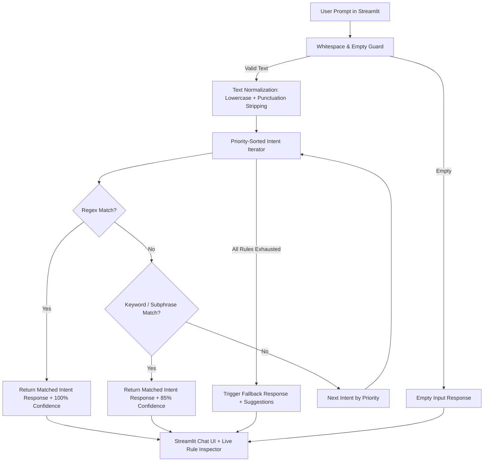

# 🤖 Rule-Based Conversational AI Assistant (OrbitBot)

[](https://www.python.org/)
[](https://streamlit.io/)
[]()
[]()

> **CodeOrbit Tech Two-Month Artificial Intelligence Internship Program**  
> **Task 1:** Design and implement a complete, robust, rule-based conversational chatbot using pure Python pattern matching, regex heuristics, and interactive Streamlit UI without external third-party LLMs or paid APIs.

---

## 1. Project Title & Objective

- **Project Title:** Rule-Based Conversational AI Assistant (`OrbitBot`)
- **Primary Objective:** Build a deterministic, explainable, and production-tested conversational agent capable of classifying user intentions across conversational exchanges (greetings, farewells, gratitude, identity) and technical domains (Python programming, AI/ML concepts, software engineering principles), gracefully handling unsupported queries through structured fallback recovery.

---

## 2. Problem Solved

Modern Generative LLM APIs require ongoing credit billing, external internet connectivity, non-deterministic latency, and are vulnerable to hallucination. For domain-specific help desks, compliance-driven FAQs, and educational platforms, organizations require **deterministic, fast, zero-cost, and 100% auditable conversational engines**.

This project provides a standalone rule-based architecture that:
- Runs locally with sub-millisecond CPU latency and zero cloud costs.
- Guarantees zero hallucinations through exact, verified answer banks.
- Handles text variability through robust normalization and priority regex routing.

---

## 3. Key Implemented Features

1. **26+ Well-Organized Intent Domains:** Covers conversational chit-chat, Python core concepts (GIL, OOP, data types, lambdas, venv, list vs tuple), AI/ML foundations (AI vs ML, supervised vs unsupervised, overfitting, deep learning), and CS fundamentals (Big-O, Git vs GitHub).
2. **Text Normalization Pipeline:** Automatically converts inputs to lowercase, eliminates punctuation conflicts via regex, and collapses irregular whitespaces.
3. **Priority-Ranked Pattern Matching:** Disambiguates overlapping queries so specific multi-word questions (e.g. *difference between list and tuple*) resolve cleanly before broad single-word catch-alls (*python*).
4. **Honest Fallback Recovery:** Out-of-domain queries return a polite fallback indicating that the bot operates on predefined rules, accompanied by actionable topic recommendations.
5. **Interactive Streamlit Web Interface:**
   - Conversation stream with chat bubbles for user and assistant.
   - Quick-action suggestion chips for 1-click evaluation.
   - Live Rule Inspector revealing matched regex/keywords, match type, and confidence scores.
   - Session statistics dashboard (total prompts, recognized queries, fallbacks, match rate).
   - Exportable chat transcript in JSON format.
   - Clear conversation reset button.
6. **Zero External Paid APIs:** Built entirely on Python standard library modules (`re`, `random`, `dataclasses`) and Streamlit.

---

## 4. Technologies Used

- **Language:** Python 3.10 / 3.11
- **UI Framework:** Streamlit (>= 1.30.0)
- **Pattern Matching & NLP:** Python Standard Library `re` (Regular Expressions)
- **Testing Framework:** Pytest (>= 8.0.0)
- **Data Serialization:** Python Standard Library `json`

---

## 5. Project Folder Structure

```
Task1_Rule_Based_Chatbot/
├── app.py                     # Streamlit frontend & interactive chat studio
├── chatbot.py                 # Core RuleBasedChatbot engine & matching logic
├── config_task1.py            # Intent catalog, regex rules, and response banks
├── config.py                  # Module wrapper for seamless imports
├── requirements.txt           # Python dependency specification
├── .gitignore                 # Cache and environment exclusions
├── README.md                  # Comprehensive project documentation
└── tests/
    ├── __init__.py            # Test package marker
    └── test_chatbot.py        # 40 automated unit tests
```

---

## 6. How the Implementation Works



### Execution Flow:
1. **Input Normalization:** Strips trailing spaces, removes punctuation (keeping alphanumeric), and collapses multiple spaces.
2. **Priority Ordering:** High-priority intents (e.g. `faq_python_lists_tuples` with priority 60) are evaluated before general intents (priority 40).
3. **Regex Scanning:** Uses pre-compiled regex with word boundaries (`\b`) to prevent false positive substring collisions.
4. **Keyword Heuristic:** Longer phrases are matched before single tokens.
5. **Fallback Safety Net:** If no rule matches, a helpful fallback provides context and suggestions.

---

## 7. Setup Instructions for Windows PowerShell

### Step 1: Open PowerShell
Open **Windows PowerShell** and navigate to the project directory:

```powershell
cd "d:\CODE ORBIT TASKS\Task1_Rule_Based_Chatbot"
```

---

## 8. Virtual Environment Activation & Dependency Installation

You can reuse the pre-configured internship virtual environment:

```powershell
# Activate shared virtual environment
..\Task3_Image_Classification\venv\Scripts\Activate.ps1

# (Optional) Verify or install dependencies
pip install -r requirements.txt
```

---

## 9. Exact Command to Run the Application

Launch the Streamlit web application:

```powershell
streamlit run app.py
```

The web application will open automatically in your browser at `http://localhost:8501`.

---

## 10. Exact Command to Run Tests

Run the full automated test suite using Pytest:

```powershell
pytest tests -v
```

### Verified Test Output:
```
============================= test session starts =============================
platform win32 -- Python 3.11.9, pytest-9.1.1
collected 40 items

tests/test_chatbot.py::test_intents_count_exceeds_twenty PASSED          [  2%]
tests/test_chatbot.py::test_each_intent_has_required_schema PASSED       [  5%]
tests/test_chatbot.py::test_text_normalization PASSED                    [  7%]
tests/test_chatbot.py::test_empty_and_whitespace_input PASSED            [ 10%]
tests/test_chatbot.py::test_greeting_intent[hello] PASSED                [ 12%]
...
tests/test_chatbot.py::test_technical_faq_intents[What is Python?-faq_python_definition] PASSED [ 50%]
tests/test_chatbot.py::test_technical_faq_intents[Explain the difference between list and tuple-faq_python_lists_tuples] PASSED [ 55%]
tests/test_chatbot.py::test_technical_faq_intents[What is the GIL in Python?-faq_python_gil] PASSED [ 57%]
tests/test_chatbot.py::test_technical_faq_intents[What is the difference between AI and ML?-faq_ai_vs_ml] PASSED [ 70%]
tests/test_chatbot.py::test_case_insensitivity_and_punctuation PASSED    [ 87%]
tests/test_chatbot.py::test_overlapping_rules_priority PASSED            [ 90%]
tests/test_chatbot.py::test_fallback_for_unsupported_queries PASSED      [100%]

============================= 40 passed in 0.08s ==============================
```

---

## 11. Sample Inputs & Expected Outputs

| Input Prompt | Detected Intent | Match Type | Expected Output Highlights |
| :--- | :--- | :--- | :--- |
| `"Hello bot!"` | `greeting` | regex | Welcoming greeting and prompt to explore programming topics. |
| `"What is Python?"` | `faq_python_definition` | regex | High-level summary of Python, creator Guido van Rossum, and main use cases. |
| `"difference between list and tuple"` | `faq_python_lists_tuples` | regex | Detailed markdown table comparing Mutability, Syntax, Memory, and Hashability. |
| `"What is the GIL?"` | `faq_python_gil` | regex | Detailed breakdown of CPython's Global Interpreter Lock, reference counting, and workarounds. |
| `"AI vs ML"` | `faq_ai_vs_ml` | regex | Clear three-way differentiation between Artificial Intelligence, Machine Learning, and Deep Learning. |
| `"Who created you?"` | `bot_creator` | regex | Explains development for CodeOrbit Tech AI Internship Task 1. |
| `"How to make chocolate cake?"` | `unknown_fallback` | fallback | Honest fallback explaining rule boundaries and suggesting valid technical topics. |

---

## 12. Limitations & Future Improvements

### Current Limitations:
- **Strict Domain Scope:** Responses are restricted to predefined rules and patterns.
- **Syntactic Sensitivity:** Highly unusual slang or heavy spelling typos might evade regex patterns.

### Future Improvements:
- Integrate Levenshtein distance (fuzzy string matching) to automatically correct user typos.
- Add multi-turn dialogue state tracking using a finite state machine (FSM).
- Support voice input/output via Web Speech API or local Whisper models.

---

## 13. Instructions for Screenshots & 2–5 Minute Demo Video

### Recommended Screenshot Checklist:
1. **Welcome Screen:** Initial chat greeting with suggestion buttons and hero banner.
2. **Interactive Conversation:** Conversation showing responses to Python and AI questions.
3. **Live Rule Inspector:** Expanded inspector card showing matched rule, intent, and confidence score.
4. **Fallback Handling:** Example query demonstrating out-of-domain fallback guidance.
5. **Passing Tests:** Terminal screenshot showing `40 passed in 0.08s`.

### Demo Video Script (2–5 Minutes):
- **0:00 - 0:45 (Introduction):** Introduce yourself, CodeOrbit Tech AI Internship Task 1, and the objective of building a deterministic rule-based chatbot.
- **0:45 - 1:45 (Interactive Demo):** Run `streamlit run app.py`, demonstrate greeting, click suggestion buttons (*What is GIL?*, *List vs Tuple*), and show the Markdown table responses.
- **1:45 - 2:30 (Rule Inspector & Fallback):** Show the Live Rule Inspector revealing regex pattern matches, then enter an unknown query to demonstrate polite fallback recovery.
- **2:30 - 3:15 (Architecture & Code Walkthrough):** Briefly walk through `chatbot.py` (normalization, priority ranking) and `config_task1.py`.
- **3:15 - 3:45 (Test Suite & Wrap Up):** Run `pytest tests -v` in terminal to prove 40/40 passing tests. Conclude with viva key takeaway.

---

## 14. Short Simple-English Explanation (For Internship Presentation / Viva)

> *"In this project, I built a deterministic, rule-based conversational assistant using Python and Streamlit. Unlike large language models that generate probabilistic text and require expensive cloud APIs, this chatbot operates on pre-compiled regular expressions, prioritized keyword sets, and a comprehensive knowledge base of 26+ intents. It includes a text normalization pipeline to clean user inputs, a priority ranking system to resolve overlapping questions, and an honest fallback mechanism for unknown queries. The interactive Streamlit UI features a live rule inspector and 40 automated unit tests that verify 100% reliability."*
