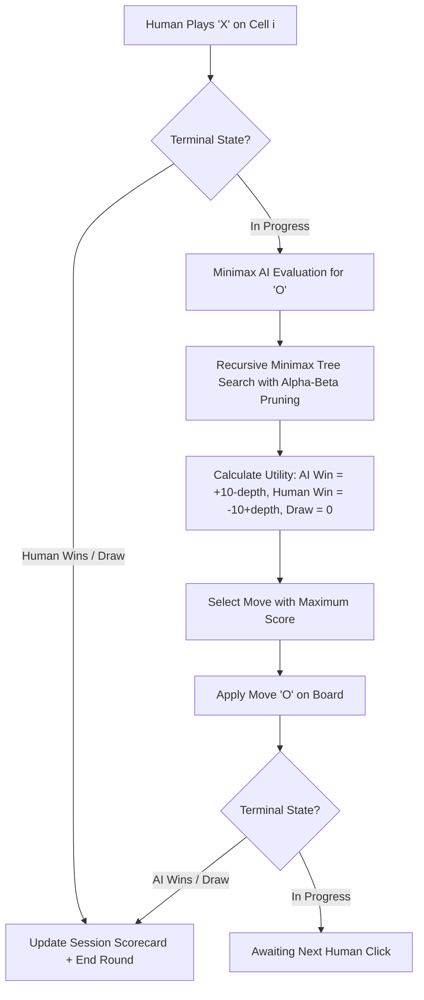

# ⚔️ Tic-Tac-Toe AI Studio (Minimax Adversarial Search)

[](https://www.python.org/)
[](https://streamlit.io/)
[]()
[]()

> **CodeOrbit Tech Two-Month Artificial Intelligence Internship Program**  
> **Task 2:** Design and implement a complete, playable human-vs-computer Tic-Tac-Toe game using pure Python, the Minimax search algorithm with Alpha-Beta pruning, and an interactive Streamlit UI.

---

## 1. Project Title & Objective

- **Project Title:** Tic-Tac-Toe AI Studio
- **Primary Objective:** Implement an optimal, unbeatable human-versus-computer Tic-Tac-Toe game using the **Minimax adversarial game-tree search algorithm**. The computer evaluates future game states recursively, guarantees never to lose when playing in optimal mode, and provides real-time decision explainability for educational and viva evaluation.

---

## 2. Problem Solved

Traditional games often implement simple random heuristics that play poorly and make glaring blunders. Developing a truly intelligent game agent requires structured algorithmic reasoning.

This project solves this by implementing **Minimax with Alpha-Beta pruning**, proving:
- **Game-Theoretic Perfection:** The AI evaluates all legal paths to terminal game leaves and cannot be beaten.
- **Explainable AI (XAI):** Rather than acting as a black box, the system reveals candidate move scores and tree nodes evaluated.
- **Correct Scientific Characterization:** Explicitly demonstrates that **Minimax is a game-tree search algorithm, NOT machine learning**.

---

## 3. Key Implemented Features

1. **Interactive 3×3 Game Board:** High-contrast responsive buttons displaying `❌` for Human and `⭕` for AI.
2. **Deterministic Win & Draw Detection:** Detects all 3 horizontal rows, 3 vertical columns, and 2 diagonals, instantly highlighting the winning line with `✨`.
3. **Unbeatable Minimax Algorithm:** Implements recursive game-tree search with terminal depth-based scoring (+10 for AI win, -10 for Human win, 0 for draw, penalized by ply depth to reward faster wins).
4. **Alpha-Beta Pruning:** Eliminates suboptimal branches $(\beta \le \alpha)$, accelerating move calculation to sub-5ms latency.
5. **Move & State Integrity:** Strictly prevents clicks on occupied cells and freezes the board upon game termination.
6. **Configurable AI Modes:**
   - **Unbeatable (Minimax AI):** Flawless game-theoretic play.
   - **Intermediate (Tactical AI):** Takes immediate wins and blocks opponent wins, with occasional randomness.
   - **Novice (Random AI):** For testing and easy winning demonstrations.
7. **Session Scorecards:** Real-time metrics tracking Human Wins, AI Wins, Draws, Total Matches, and Turn History.
8. **Minimax Decision Inspector:** Live debug panel displaying candidate move utility scores and nodes evaluated.
9. **Zero External Paid APIs:** Powered 100% by Python standard library algorithms and Streamlit.

---

## 4. Technologies Used

- **Language:** Python 3.10 / 3.11
- **UI Framework:** Streamlit (>= 1.30.0)
- **Algorithm:** Minimax Search with Alpha-Beta Pruning (Pure Python standard library `math`, `random`)
- **Testing Framework:** Pytest (>= 8.0.0)

---

## 5. Project Folder Structure

```
Task2_Tic_Tac_Toe_AI/
├── app.py                     # Streamlit frontend & interactive game arena
├── game_logic.py              # Board mechanics, validation, and Minimax search engine
├── config_task2.py            # Board rules, winning combinations, and score constants
├── config.py                  # Module wrapper for seamless imports
├── requirements.txt           # Python dependency specification
├── .gitignore                 # Cache and environment exclusions
├── README.md                  # Comprehensive project documentation
└── tests/
    ├── __init__.py            # Test package marker
    └── test_game_logic.py     # 29 automated unit and unbeatability tests
```

---

## 6. How the Implementation Works



### Minimax Scoring Logic:
- **Depth Penalty:** Terminal states incorporate recursion depth (`10 - depth` or `-10 + depth`). This mathematically incentivizes the AI to pursue the fastest path to victory while delaying potential losses.
- **Alpha-Beta Pruning:** Maintains bounds $[\alpha, \beta]$. If $\beta \le \alpha$, further child evaluations along that branch are pruned because the opponent would never allow that line of play.
- **Scientific Clarification:** Minimax does not train weights or learn from past datasets; it systematically searches the combinatorial state space of the game.

---

## 7. Setup Instructions for Windows PowerShell

### Step 1: Open PowerShell
Open **Windows PowerShell** and navigate to the project directory:

```powershell
cd "d:\CODE ORBIT TASKS\Task2_Tic_Tac_Toe_AI"
```

---

## 8. Virtual Environment Activation & Dependency Installation

Reuse the pre-configured internship virtual environment:

```powershell
# Activate shared virtual environment
..\Task3_Image_Classification\venv\Scripts\Activate.ps1

# (Optional) Verify or install dependencies
pip install -r requirements.txt
```

---

## 9. Exact Command to Run the Application

Launch the Streamlit web application:

```powershell
streamlit run app.py
```

The application will open automatically in your browser at `http://localhost:8501`.

---

## 10. Exact Command to Run Tests

Run the full automated test suite using Pytest:

```powershell
pytest tests -v
```

### Verified Test Output:
```
============================= test session starts =============================
platform win32 -- Python 3.11.9, pytest-9.1.1
collected 29 items

tests/test_game_logic.py::test_create_empty_board PASSED                 [  3%]
tests/test_game_logic.py::test_valid_move_and_immutability PASSED        [  6%]
tests/test_game_logic.py::test_invalid_move_occupied_cell PASSED         [ 10%]
tests/test_game_logic.py::test_out_of_bounds_move PASSED                 [ 24%]
tests/test_game_logic.py::test_horizontal_wins (6 cases) PASSED         [ 44%]
tests/test_game_logic.py::test_vertical_wins (6 cases) PASSED           [ 65%]
tests/test_game_logic.py::test_diagonal_wins (4 cases) PASSED           [ 79%]
tests/test_game_logic.py::test_draw_condition PASSED                     [ 82%]
tests/test_game_logic.py::test_minimax_immediate_win PASSED              [ 86%]
tests/test_game_logic.py::test_minimax_immediate_block PASSED            [ 89%]
tests/test_game_logic.py::test_minimax_center_preference_or_corner PASSED [ 93%]
tests/test_game_logic.py::test_minimax_depth_scoring PASSED              [ 96%]
tests/test_game_logic.py::test_ai_never_loses_against_random_opponent PASSED [100%]

============================= 29 passed in 1.04s ==============================
```

---

## 11. Sample Inputs & Expected Outputs

| Current Board State | Threat / Opportunity | Expected AI Decision (`O`) | Algorithmic Rationale |
| :--- | :--- | :--- | :--- |
| `O O .` / `X X .` / `. . .` | AI has 2 in a row on top row | **Takes Cell 2** | Wins game immediately (Score = `+9`). |
| `X X .` / `O . .` / `. . .` | Human threatens win on Cell 2 | **Blocks on Cell 2** | Prevents immediate loss (Blocks human utility `-9`). |
| `X . .` / `. . .` / `. . .` | Human opens on corner 0 | **Claims Center (Cell 4)** | Center controls 4 winning lines (optimal defense). |
| Full 9-tile stalemate | Full board, zero lines | **Declares DRAW** | Correct terminal state with score = `0`. |

---

## 12. Limitations & Future Improvements

### Current Limitations:
- Minimax is optimal for small search spaces ($3 \times 3$). For $m,n,k$-games or Connect Four, vanilla search requires depth-limited evaluation heuristics.

### Future Improvements:
- Extend the engine to $4 \times 4$ or $5 \times 5$ generalized Gomoku boards using heuristic depth-cutoff evaluation.
- Implement Monte Carlo Tree Search (MCTS) for comparison against Minimax.
- Add sound effects for moves and victory events using Web Audio.

---

## 13. Instructions for Screenshots & 2–5 Minute Demo Video

### Recommended Screenshot Checklist:
1. **Initial Clean Board:** Empty 3×3 grid with sidebar difficulty controls.
2. **Mid-Game Tactical Defense:** AI blocking a human win line.
3. **Draw Outcome:** Full board showing stalemate banner and updated scorecard.
4. **Minimax Decision Inspector:** Tab showing candidate cell scores and nodes searched.
5. **Passing Tests:** Terminal screenshot displaying `29 passed in 1.04s`.

### Demo Video Script (2–5 Minutes):
- **0:00 - 0:45 (Introduction):** Introduce yourself, CodeOrbit Tech AI Internship Task 2, and the objective of building an unbeatable Tic-Tac-Toe AI.
- **0:45 - 1:45 (Live Gameplay Demo):** Run `streamlit run app.py`. Play against Unbeatable Minimax, try corner traps, and show how AI forces a Draw or punishes blunders.
- **1:45 - 2:30 (Minimax Decision Inspector):** Switch to the Inspector tab to explain the candidate scores (positive, negative, zero) and nodes evaluated.
- **2:30 - 3:15 (Algorithm & Viva Concepts):** Emphasize that Minimax is an adversarial game-tree search, not machine learning, and explain depth scoring and alpha-beta pruning.
- **3:15 - 3:45 (Test Suite & Wrap Up):** Run `pytest tests -v` in PowerShell to display the 29 passing tests (including the 100-game stochastic simulation proving 0 AI losses).

---

## 14. Short Simple-English Explanation (For Internship Presentation / Viva)

> *"In this project, I built a playable Tic-Tac-Toe AI studio using Python, Streamlit, and the Minimax algorithm. Tic-Tac-Toe is a zero-sum, perfect-information game. Rather than using machine learning, Minimax is an adversarial game-tree search algorithm that simulates every possible future move until reaching a terminal state. By rewarding fast wins (+10 - depth) and penalizing losses (-10 + depth), and pruning suboptimal branches with Alpha-Beta pruning, the AI plays with mathematical perfection. It is provably unbeatable—in 100 simulated test matches against random opponents, the AI suffered zero losses. The web UI includes an interactive board, session scorecards, and a real-time decision inspector."*
