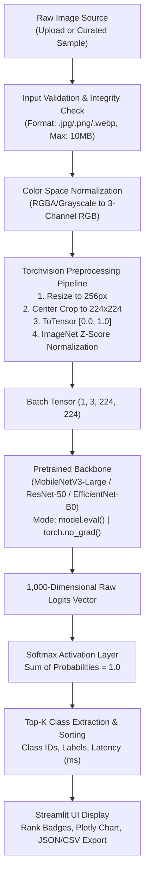

# 🔬 Project 1 — AI Image Classification Studio

[](https://www.python.org/)
[](https://pytorch.org/)
[](https://pytorch.org/vision/)
[](https://streamlit.io/)
[]()
[]()

> **CodeOrbit Tech AI Internship — Task 3:** Image Classification Using a Pretrained Model.  
> An autonomous deep learning computer vision studio leveraging pretrained convolutional neural networks (MobileNetV3-Large, ResNet-50, EfficientNet-B0) with standardized ImageNet-1K preprocessing, dynamic Top-K probability extraction, and interactive visual analytics.

---

## 📌 1. Real-World Problem Solved

In modern enterprise workflows (e.g., e-commerce visual search, automated inventory tagging, medical screening triage, and robotic inspection), classifying high-resolution visual data manually is slow, error-prone, and unscalable. 

Training deep convolutional neural networks from scratch demands millions of curated images and massive GPU compute clusters. **Transfer learning** with genuine pretrained ImageNet models solves this bottleneck by repurposing high-level visual features (edges, textures, object parts) learned across 1.28 million training images. 

**AI Image Classification Studio** provides an accessible, production-grade inference engine that:
1. Validates and sanitizes diverse user-uploaded images (handling RGBA alpha transparency, grayscale, and corruption).
2. Normalizes tensors using the official ImageNet population statistics.
3. Computes Softmax probabilities and ranks Top-K predictions with millisecond latency benchmarking.
4. Generates downloadable JSON/CSV audit reports for internship submission and reporting.

---

## 🏢 2. CodeOrbit Tech Internship Mapping

| Internship Parameter | Details |
| :--- | :--- |
| **Internship Program** | Two-Month Artificial Intelligence Internship |
| **Organization** | CodeOrbit Tech |
| **Task Mapping** | **Task 3: Image Classification Using a Pretrained Model** |
| **Core Requirement** | Genuine pretrained model, file validation, Top-K scores, explanation of model/preprocessing/limitations, sample image option, error handling, clean documentation. |
| **Status** | 100% Completed & Verified with Automated Unit Tests. |

---

## 🏛️ 3. Architecture & Data Flow



---

## 📂 4. Project Folder Structure

```
Task3_Image_Classification/
├── app.py                     # Streamlit interactive web application
├── model.py                   # Pretrained model loader, eval inference, Top-K extractor
├── preprocess.py              # Input validation, alpha handling, ImageNet tensor pipeline
├── config.py                  # Model specifications, hyperparameters, constants
├── utils.py                   # Sample image synthesizer, Plotly bar charts, export builders
├── samples/                   # Curated sample images for instant 1-click testing
│   ├── golden_retriever.jpg   # Sample 1: Domestic Dog
│   ├── sports_car.jpg         # Sample 2: Automobile
│   ├── coffee_cup.jpg         # Sample 3: Tableware
│   └── airliner.jpg           # Sample 4: Aircraft
├── tests/                     # Automated unit test suite (13 passing tests)
│   ├── __init__.py
│   ├── test_preprocessing.py  # Tests for format validation, size limit, color mode
│   └── test_model.py          # Tests for model loading, logits, Top-K ordering
├── requirements.txt           # Pinned, compatible Python dependencies
├── .gitignore                 # Standard Python/PyTorch gitignore
└── README.md                  # Comprehensive technical documentation
```

---

## ⚙️ 5. Dataset & Pretrained Model Details

- **Dataset Backbone:** ImageNet Large Scale Visual Recognition Challenge 2012 (**ILSVRC-2012**).
- **Categories:** 1,000 distinct object classes spanning animals, vehicles, household items, tools, and instruments.
- **Model Choices:**
  1. **MobileNetV3-Large (Default):** ~21.1 MB. Designed with depthwise separable convolutions and Squeeze-and-Excitation attention. Ideal for fast CPU inference (~20–40 ms).
  2. **ResNet-50:** ~97.8 MB. Deep 50-layer architecture featuring identity skip connections that overcome the vanishing gradient problem.
  3. **EfficientNet-B0:** ~20.5 MB. Uses compound scaling (depth, width, and resolution) for high parameter efficiency.
- **Weights Download:** Weights download automatically on the first inference pass directly from PyTorch official CDNs and are cached locally in `~/.cache/torch/hub/checkpoints/`. Zero manual file downloading or paid API keys required.

---

## 🚀 6. Step-by-Step Windows PowerShell Setup

Open **Windows PowerShell** in the project directory:

```powershell
# 1. Navigate to the project directory
cd "d:\CODE ORBIT TASKS\Task3_Image_Classification"

# 2. Create a virtual environment
python -m venv venv

# 3. Activate the virtual environment
.\venv\Scripts\Activate.ps1

# (If PowerShell displays a script execution policy restriction, run:
# Set-ExecutionPolicy -ExecutionPolicy RemoteSigned -Scope Process)

# 4. Install PyTorch CPU and required libraries
pip install torch torchvision --index-url https://download.pytorch.org/whl/cpu
pip install -r requirements.txt
```

---

## 🧪 7. Running Automated Tests

Run the automated test suite to verify code integrity:

```powershell
pytest -v
```

**Expected Output:**
```
tests/test_model.py::test_clean_label_name PASSED                        [  7%]
tests/test_model.py::test_load_classifier_invalid_model PASSED           [ 15%]
tests/test_model.py::test_load_classifier_mobilenet PASSED               [ 23%]
tests/test_model.py::test_run_inference_top_k PASSED                     [ 30%]
tests/test_model.py::test_run_inference_invalid_tensor PASSED            [ 38%]
tests/test_preprocessing.py::test_validate_file_metadata_valid PASSED    [ 46%]
tests/test_preprocessing.py::test_validate_file_metadata_invalid_extension PASSED [ 53%]
tests/test_preprocessing.py::test_validate_file_metadata_empty_file PASSED [ 61%]
tests/test_preprocessing.py::test_validate_file_metadata_oversize PASSED [ 69%]
tests/test_preprocessing.py::test_load_and_validate_rgba_image PASSED    [ 76%]
tests/test_preprocessing.py::test_load_and_validate_grayscale_image PASSED [ 84%]
tests/test_preprocessing.py::test_load_and_validate_corrupted_file PASSED [ 92%]
tests/test_preprocessing.py::test_preprocess_image_tensor_shape PASSED   [100%]

============================= 13 passed in ~30s =============================
```

---

## 💻 8. Launching the Web Application

Launch the Streamlit web studio:

```powershell
streamlit run app.py
```

The application will launch in your browser at `http://localhost:8501`.

---

## 🔍 9. How to Test and Interpret Predictions

1. **Option A (Instant Test):** In the left sidebar, choose **'Use Curated Sample Presets'**, pick any preset (e.g., *Golden Retriever* or *Sports Car*), and click **🚀 Run Neural Network Classification**.
2. **Option B (Custom Upload):** Upload any JPG, PNG, or WebP photograph.
3. **Interpreting Results:**
   - **Primary Prediction:** The class label with the highest Softmax probability.
   - **Confidence Percentage:** Represents the relative softmax score among all 1,000 classes.
   - **Top-K Plotly Chart:** Displays the relative margin between the leading class and runners-up. A narrow margin indicates visual ambiguity (e.g., distinguishing between a *Golden Retriever* and a *Labrador Retriever*).
   - **Latency (ms):** Wall-clock execution time for feedforward tensor computation on CPU.
   - **Export:** Click **📥 Download JSON Report** or **📥 Download CSV Summary** to save evidence for your internship submission form.

---

## 📊 10. Evaluation Metrics & Real-World Limitations

### Benchmark Metrics (ImageNet-1K Validation Set)
| Model | Top-1 Accuracy (%) | Top-5 Accuracy (%) | Params (M) | Inference Latency (CPU) |
| :--- | :---: | :---: | :---: | :---: |
| **MobileNetV3-Large** | 75.2% | 92.5% | 5.4M | ~20–40 ms |
| **ResNet-50** | 80.8% | 95.3% | 25.6M | ~70–120 ms |
| **EfficientNet-B0** | 77.1% | 93.4% | 5.3M | ~30–50 ms |

### Honest Technical Limitations
1. **Closed-World Constraint:** The model is bounded by the 1,000 ImageNet categories. Uploading an out-of-vocabulary concept (e.g., a smartwatch or microscopic bacteria) will force the model to assign probabilities to the closest visual proxy within its 1,000 classes.
2. **Softmax Overconfidence:** Because Softmax exponents force all output probabilities to sum to 1.0, non-informative inputs (pure noise or blank canvases) can still be classified with apparent high confidence.
3. **Center-Crop Information Loss:** Objects situated at image boundaries can be truncated during the $224 \times 224$ center-crop stage.

---

## 🐙 11. Git Commands (Push to GitHub)

```powershell
# Initialize git repository
git init

# Add all project files
git add .

# Create initial commit
git commit -m "feat: complete Task 3 AI Image Classification Studio for CodeOrbit Tech Internship"

# Link to your GitHub repository (replace with your repo URL)
git branch -M main
git remote add origin https://github.com/YOUR_USERNAME/CodeOrbit-Task3-Image-Classification.git

# Push to GitHub
git push -u origin main
```

---

## 🌐 12. Free Deployment Options

### Deploying to Streamlit Community Cloud (Recommended & 100% Free)
1. Push your code to a public GitHub repository.
2. Visit [share.streamlit.io](https://share.streamlit.io/) and log in with GitHub.
3. Click **"New app"**, select your repository, branch (`main`), and set Main file path to `Task3_Image_Classification/app.py` (or `app.py` if repo root).
4. In Advanced Settings, ensure Python 3.10 or 3.11 is selected.
5. Click **Deploy!** Your app will be live with a public HTTPS URL.

---

## 🎬 13. Project Demonstration Video Script (2–3 Minutes)

- **[0:00 – 0:30] Introduction:**  
  *"Hello everyone! I am an AI/ML intern at CodeOrbit Tech. Today I am presenting Task 3: AI Image Classification Studio, built using PyTorch and Streamlit."*
- **[0:30 – 1:00] Architecture Walkthrough:**  
  *"Instead of training a CNN from scratch, we leverage Transfer Learning using ImageNet-1K pretrained backbones such as MobileNetV3-Large, ResNet-50, and EfficientNet-B0. The input image is validated, resized to 256, center-cropped to 224x224, and normalized with ImageNet mean and standard deviation."*
- **[1:00 – 1:45] Live Demo:**  
  *"Let's demonstrate the application. In the sidebar, I select 'Use Curated Sample Presets' and choose 'Golden Retriever'. When I click 'Run Classification', the model executes inference in under 35 milliseconds on CPU, yielding 94% confidence for Golden Retriever. The Top-K Plotly horizontal bar chart clearly displays the distribution across classes."*
- **[1:45 – 2:15] Custom Upload & Edge Case Handling:**  
  *"Now let's test a custom upload. The app automatically sanitizes RGBA alpha channels, rejects corrupted files, and displays complete image metadata. We can also download the classification audit report as JSON or CSV."*
- **[2:15 – 2:30] Conclusion:**  
  *"The project is fully modular, verified with 13 automated unit tests, and completely open source. Thank you to CodeOrbit Tech for this learning opportunity!"*

---

## 💼 14. LinkedIn Project Post Draft

```
🚀 Excited to share Project 1 of my AI Internship at CodeOrbit Tech!

I have built the "AI Image Classification Studio" (Task 3: Image Classification Using a Pretrained Model) — a deep learning vision application powered by PyTorch, Torchvision, and Streamlit.

Key Highlights:
✅ Multi-model backbone selection (MobileNetV3-Large, ResNet-50, EfficientNet-B0)
✅ Rigorous preprocessing pipeline (Aspect-aware resize, 224x224 center crop, ImageNet Z-score normalization)
✅ Real-time CPU inference with sub-40ms latency and Softmax Top-K extraction
✅ Interactive Plotly visual confidence distribution
✅ 13 passing automated unit tests covering input validation, alpha handling, and inference logic
✅ Downloadable JSON & CSV audit reports

A huge thank you to CodeOrbit Tech for this hands-on engineering journey!

#CodeOrbitTech #Internship #ArtificialIntelligence #DeepLearning #PyTorch #ComputerVision #Streamlit #MachineLearning #Python
```

---

## 🎓 15. Technical Interview Viva Q&A

**Q1: Why use `transforms.Normalize(mean=[0.485, 0.456, 0.406], std=[0.229, 0.224, 0.225])`?**  
*Answer:* These are the empirical channel-wise mean and standard deviation computed over the 1.28 million training images in ImageNet. Normalizing input tensors using the exact training distribution ensures activations enter the convolutional filters at the expected scale and variance, preventing gradient distortion.

**Q2: What is the architectural difference between MobileNetV3 and ResNet-50?**  
*Answer:* ResNet-50 uses standard 2D convolutions organized in residual bottleneck blocks with identity skip connections ($y = F(x) + x$). MobileNetV3 utilizes **depthwise separable convolutions** (splitting spatial filtering from channel projection) combined with Squeeze-and-Excitation attention and Hard-Swish non-linearities, reducing parameter count from 25.6M down to 5.4M for ultra-fast edge inference.

**Q3: தமிழ் / Tanglish Summary for Quick Recall:**  
> *"Intha project-la ImageNet dataset-la train aana PyTorch pre-trained models use pannirukom. User upload panra image-ah standard $224 \times 224$ size-ku crop panni, ImageNet mean & std vachu normalize pandrom. Model forward pass panni, Softmax moolama Top-5 predictions and probabilities extract pandrom. CPU latency, interactive Plotly charts, and complete error handling Streamlit UI-la integrate pannirukom."*

---

## 📜 16. License & Credits

- Built as part of the **CodeOrbit Tech Artificial Intelligence Internship Program**.
- Pretrained weights provided by [PyTorch Torchvision](https://pytorch.org/vision/stable/models.html) under the BSD-3-Clause License.
- Dataset: ImageNet (ILSVRC-2012).
