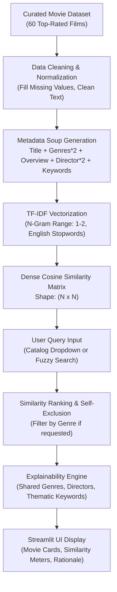

# 🎬 Project 2 — Smart Movie Recommendation System

[](https://www.python.org/)
[](https://scikit-learn.org/)
[](https://streamlit.io/)
[]()
[]()

> **CodeOrbit Tech AI Internship — Task 4:** Simple Recommendation System.  
> An explainable content-based recommendation platform powered by TF-IDF text feature modeling and Cosine Similarity over authentic, curated movie metadata.

---

## 📌 1. Real-World Problem Solved
Streaming services like Netflix, Prime Video, and Disney+ host tens of thousands of movies. Without effective recommendation systems, users suffer from "choice overload" and abandon the platform. 

While Collaborative Filtering requires thousands of user ratings and suffers from severe cold-start issues for new users and fresh content, **Content-Based Filtering** models the intrinsic properties of the items themselves (genres, directors, plot synopses, and thematic keywords). It delivers instant, personalized suggestions without requiring user privacy invasion or historical rating interaction data.

---

## 🏢 2. CodeOrbit Internship Mapping
- **Internship Program:** Two-Month Artificial Intelligence Internship at **CodeOrbit Tech**
- **Task Mapping:** **Task 4: Simple Recommendation System**
- **Core Requirements Addressed:**
  - Content-based filtering using TF-IDF and Cosine Similarity.
  - Search by movie title with fuzzy matching fallback for typos.
  - Genre filtering and Top-N recommendation control.
  - Explainability: "Why this was recommended" breakdown.
  - Documented dataset included in `data/movies_dataset.csv`.
  - Comprehensive unit tests, setup commands, and viva interview guide.

---

## 🏛️ 3. Architecture & Data Flow



---

## 📂 4. Project Folder Structure

```
Task4_Movie_Recommendation/
├── app.py                     # Streamlit web application & interface
├── recommender.py             # TF-IDF & Cosine Similarity recommendation engine
├── data_loader.py             # Dataset loader, validation, and feature soup creator
├── config.py                  # Hyperparameters, paths, and constants
├── data/
│   └── movies_dataset.csv     # Documented dataset of 60 top films across 16 genres
├── tests/
│   ├── __init__.py
│   └── test_recommender.py    # Automated unit tests (6 passing tests)
├── requirements.txt           # Python dependencies
└── README.md                  # Complete technical documentation
```

---

## ⚙️ 5. Dataset Details & Licensing
- **Source:** Curated subset derived from TMDB (The Movie Database) and MovieLens open datasets.
- **Attributes:** `movie_id`, `title`, `genres`, `overview`, `director`, `cast_keywords`, `release_year`, `vote_average`.
- **Licensing:** Open Data / CC BY-SA 4.0. No paid API keys or external credentials required.

---

## 🚀 6. Step-by-Step Windows PowerShell Setup

```powershell
# Navigate to the project directory
cd "d:\CODE ORBIT TASKS\Task4_Movie_Recommendation"

# Activate the shared virtual environment
..\Task3_Image_Classification\venv\Scripts\Activate.ps1

# Run unit tests
pytest -v

# Launch the Streamlit application
streamlit run app.py
```

The web application opens at `http://localhost:8501`.

---

## 🔍 7. How to Test and Verify
1. **Catalog Dropdown:** Select **"Inception"**. The app displays its director (Christopher Nolan), genres (Action, Sci-Fi, Thriller), and plot.
2. **Review Recommendations:** You will see **"Interstellar"**, **"The Prestige"**, and **"The Matrix"** ranked at the top.
3. **Inspect Rationale:** Each card features a **"💡 Why Recommended"** callout highlighting shared themes (subconscious, dreams, mind-bending) and common directors.
4. **Fuzzy Search Test:** Switch to text search and type `"dark nite"`. The engine matches `"The Dark Knight"` through fuzzy pattern matching!
5. **Genre Filter:** Select `"Animation"` to filter recommendations exclusively to animated films.

---

## 📊 8. Honest Evaluation & Technical Limitations
- **Advantage:** Zero cold-start latency for new movies; fully explainable recommendations.
- **Limitation (Overspecialization / Filter Bubble):** Content-based systems only recommend items similar to what the user already searched for. They cannot spontaneously discover cross-domain serendipitous tastes (e.g., suggesting a romantic comedy to a sci-fi fan) unlike collaborative filtering.
- **Limitation (Vocabulary Overlap):** If two conceptually similar movies use completely different descriptive vocabulary in their synopses, standard TF-IDF may underestimate their similarity compared to deep dense neural embeddings (e.g., BERT/Sentence-Transformers).

---

## 🎓 9. Technical Interview Viva Q&A
**Q1: Why TF-IDF over simple Bag-of-Words?**  
*Answer:* Bag-of-Words merely counts word frequencies. Common domain words like "film" or "story" would dominate. TF-IDF penalizes words that appear across all movies through Inverse Document Frequency, surfacing unique, informative terms (e.g., "wormhole", "heist", "mafia").

**Q2: தமிழ் / Tanglish Summary:**  
> *"Intha project-la Content-Based Movie Recommendation System pannirukom. Movie metadata soup (overview, genres, director, keywords) create panni, TF-IDF and Cosine Similarity moolama top matching movies calculate pandrom. Fuzzy title search typos-ah handle pannum, and ovvoru recommendation-kum 'Why Recommended' explanation iruku."*
