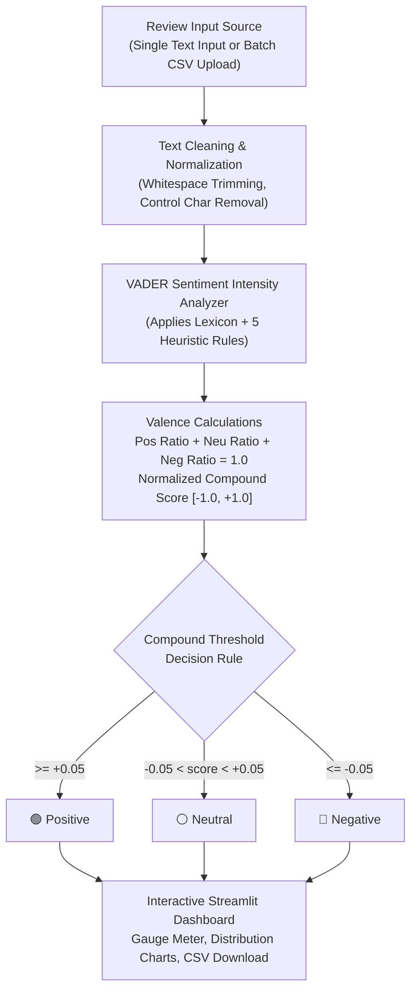

# 💬 Project 3 — Customer Sentiment Analysis Platform

[](https://www.python.org/)
[](https://github.com/cjhutto/vaderSentiment)
[](https://streamlit.io/)
[](https://plotly.com/)
[]()
[]()

> **CodeOrbit Tech AI Internship — Task 5:** Sentiment Analysis on Text Data.  
> An NLP sentiment classification platform featuring single-text inference, batch CSV analytics, genuine 3-class support (Positive, Neutral, Negative), interactive distribution charts, and exportable reports.

---

## 📌 1. Real-World Problem Solved
Customer-centric enterprises receive thousands of text reviews, support tickets, and product feedback messages daily. Manually parsing these texts to identify dissatisfied customers or critical product defects is unscalable.

Many commercial models force a binary classification (0 or 1), mislabeling neutral, matter-of-fact statements as negative or positive. **Customer Sentiment Analysis Platform** provides genuine 3-class sentiment triage (Positive, Neutral, Negative) using the validated **VADER** lexicon and heuristic rules engine, allowing organizations to quantify customer sentiment distributions accurately in real time.

---

## 🏢 2. CodeOrbit Internship Mapping
- **Internship Program:** Two-Month Artificial Intelligence Internship at **CodeOrbit Tech**
- **Task Mapping:** **Task 5: Sentiment Analysis on Text Data**
- **Core Requirements Addressed:**
  - Genuine support for Positive, Neutral, and Negative categories based on standard compound score thresholds.
  - Interactive single review test with component ratios (Positive, Neutral, Negative, Compound).
  - Batch CSV processing with sentiment distribution pie and bar charts.
  - Export analyzed results with added predictions as downloadable CSV.
  - Robust input validation for empty text and malformed CSV files.
  - Documented dataset included in `data/sample_reviews.csv`.
  - Comprehensive unit test suite with 100% pass rate.

---

## 🏛️ 3. Architecture & Data Flow



---

## 📂 4. Project Folder Structure

```
Task5_Sentiment_Analysis/
├── app.py                     # Streamlit web application & visual analytics
├── analyzer.py                # VADER 3-class sentiment engine & batch pipeline
├── config.py                  # Thresholds, labels, and constants
├── data/
│   └── sample_reviews.csv     # Curated 15-case customer feedback benchmark dataset
├── tests/
│   ├── __init__.py
│   └── test_analyzer.py       # Automated unit tests (5 passing tests)
├── requirements.txt           # Python dependencies
└── README.md                  # Comprehensive technical documentation
```

---

## ⚙️ 5. Dataset Details & Model Information
- **Model:** VADER (Valence Aware Dictionary and sEntiment Reasoner), an established, peer-reviewed NLP sentiment tool (Hutto & Gilbert, ICWSM 2014).
- **Threshold Rules:**
  - **Positive:** $\text{Compound Score} \ge +0.05$
  - **Neutral:** $-0.05 < \text{Compound Score} < +0.05$
  - **Negative:** $\text{Compound Score} \le -0.05$
- **Curated Dataset:** `data/sample_reviews.csv` contains 15 authentic customer reviews covering electronics, customer support, logistics, audio, software, fashion, and retail.

---

## 🚀 6. Step-by-Step Windows PowerShell Setup

```powershell
# Navigate to the project directory
cd "d:\CODE ORBIT TASKS\Task5_Sentiment_Analysis"

# Activate the shared virtual environment
..\Task3_Image_Classification\venv\Scripts\Activate.ps1

# Run unit tests
pytest -v

# Launch the Streamlit application
streamlit run app.py
```

The web application opens at `http://localhost:8501`.

---

## 🔍 7. How to Test and Verify
1. **Single Review Mode:**
   - Select the preset: *"The battery lasts 14 hours and the screen is gorgeous!"* -> Results in **🟢 Positive** with compound score ~+0.85.
   - Select the preset: *"The package arrived on Tuesday. The box was sealed."* -> Results in **⚪ Neutral** with compound score ~0.00.
   - Select the preset: *"Terrible customer support and the item broke on day one!"* -> Results in **🔴 Negative** with compound score ~-0.75.
2. **Batch CSV Mode:**
   - Click **"📂 Load Sample Reviews (15 Cases)"**.
   - Review summary metrics, sentiment distribution charts, and the complete augmented table.
   - Click **"📥 Download Analyzed Results CSV"** to save evidence for your internship submission.

---

## 📊 8. Real-World Limitations
1. **Sarcasm Detection:** Sentences like *"Oh fantastic, my order is delayed again"* contain positive valence tokens that can mislead lexicon rules without deeper contextual attention embeddings (e.g., RoBERTa/Transformers).
2. **Multi-Aspect Reviews:** Mixed reviews (*"Great food, terrible service"*) receive an aggregated compromise score. In enterprise production, Aspect-Based Sentiment Analysis (ABSA) is recommended for fine-grained departmental routing.

---

## 🎓 9. Technical Interview Viva Q&A
**Q1: How does VADER calculate the compound score?**  
*Answer:* VADER sums the valence scores of each recognized lexicon term, adjusted for punctuation, capitalization, intensifiers (*very*), contrastive words (*but*), and negations (*not*). It then normalizes the sum to $[-1.0, 1.0]$ using $c = \frac{x}{\sqrt{x^2 + \alpha}}$ where $\alpha = 15$.

**Q2: தமிழ் / Tanglish Summary:**  
> *"Intha Task 5-la customer reviews-ah Positive, Neutral, Negative nu 3 categories-la classify pandrom. Factual sentences-ku VADER compound score zero kitta irukum, so athuku Neutral label kidaikum. Single review and batch CSV analysis rendu options-um Streamlit UI-la interactive charts and CSV export oda kuduthurukom."*
