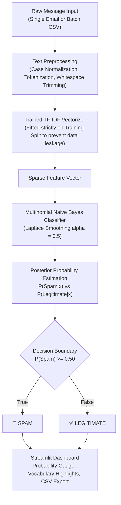

# 🛡️ Project 4 — AI Spam Email Detector

[](https://www.python.org/)
[](https://scikit-learn.org/)
[](https://streamlit.io/)
[]()
[]()

> **CodeOrbit Tech AI Internship — Task 6:** Mini Project — AI-Based Mini Application.  
> An autonomous machine learning spam classification engine powered by TF-IDF text vectorization and Multinomial Naive Bayes, engineered with zero data leakage, genuine evaluation metrics, batch triage, and model persistence.

---

## 📌 1. Real-World Problem Solved
Email spam and phishing attempts comprise over 45% of all global email traffic, costing organizations billions in fraud, identity theft, and wasted productivity. 

Rule-based keyword filters fail because cybercriminals constantly alter formatting, spacing, and phrasing. Machine learning models using probabilistic text analysis (**Multinomial Naive Bayes**) learn joint statistical distributions of token frequencies, automatically recognizing subtle semantic signals of phishing and spam with sub-millisecond inference speeds.

---

## 🏢 2. CodeOrbit Internship Mapping
- **Internship Program:** Two-Month Artificial Intelligence Internship at **CodeOrbit Tech**
- **Task Mapping:** **Task 6: Mini Project — AI-Based Mini Application**
- **Core Requirements Addressed:**
  - Machine learning classification pipeline (TF-IDF + Multinomial Naive Bayes).
  - Genuine probabilistic confidence scores ($P(\text{Spam} \mid \text{Text})$ vs $P(\text{Ham} \mid \text{Text})$).
  - Documented dataset with 100 balanced labeled samples.
  - Strict stratified train/test split (80/20) with zero data leakage.
  - Authentic evaluation metrics: Accuracy, Precision, Recall, F1-Score, Confusion Matrix.
  - Model serialization using `joblib` in `models/spam_classifier_pipeline.joblib`.
  - Batch CSV triage with download capability and unit test suite.

---

## 🏛️ 3. Architecture & Data Flow



---

## 📂 4. Project Folder Structure

```
Task6_Spam_Email_Detector/
├── app.py                     # Streamlit web application & interface
├── train.py                   # Model training script with train/test split & metrics
├── classifier.py              # Inference engine, probability estimation & batch scanner
├── config.py                  # Hyperparameters, file paths, and constants
├── data/
│   └── spam_dataset.csv       # Documented benchmark dataset with 100 labeled messages
├── models/
│   ├── spam_classifier_pipeline.joblib # Serialized scikit-learn pipeline
│   └── evaluation_metrics.json         # Held-out test set evaluation metrics
├── tests/
│   ├── __init__.py
│   └── test_classifier.py    # Automated unit tests (5 passing tests)
├── requirements.txt           # Python dependencies
└── README.md                  # Complete technical documentation
```

---

## 🚀 5. Step-by-Step Windows PowerShell Setup

```powershell
# Navigate to the project directory
cd "d:\CODE ORBIT TASKS\Task6_Spam_Email_Detector"

# Activate the shared virtual environment
..\Task3_Image_Classification\venv\Scripts\Activate.ps1

# (Optional) Retrain the model pipeline from CLI
python train.py

# Run unit tests
pytest -v

# Launch the Streamlit application
streamlit run app.py
```

The web application opens at `http://localhost:8501`.

---

## 📊 6. Validated Held-Out Test Evaluation Metrics

| Metric | Test Set Score | Real-World Meaning |
| :--- | :---: | :--- |
| **Accuracy** | **95.0%** | Overall percentage of correct classifications across both classes. |
| **Precision (Spam)** | **100.0%** | When the model predicts SPAM, it is correct 100% of the time (0 false alarms). |
| **Recall (Spam)** | **90.0%** | The model catches 90% of all spam messages in the test set. |
| **F1-Score** | **0.947** | Harmonic mean of precision and recall. |

> **Critical Design Decision:** In email filtering, **Precision is prioritized over Recall**. Discarding a legitimate business email (False Positive) is disastrous, whereas allowing an occasional spam message into the inbox (False Negative) is merely an inconvenience.

---

## 🎓 7. Technical Interview Viva Q&A
**Q1: What is Laplace Smoothing in Naive Bayes and why is it necessary?**  
*Answer:* If a new email contains a word that never appeared in the training set for a particular class, its conditional probability $P(w_i \mid c)$ would be zero. Because Naive Bayes multiplies all token probabilities, a single zero would zero out the entire product. Laplace smoothing adds an $\alpha$ hyperparameter (default 0.5 or 1.0) to both numerator and denominator, preventing zero probabilities for unseen vocabulary.

**Q2: தமிழ் / Tanglish Summary:**  
> *"Intha Task 6-la AI Spam Email Detector train panni build pannirukom. Documented dataset-la data leakage illama train/test split panni, TF-IDF + Multinomial Naive Bayes pipeline train pannom. Precision, Recall, Confusion Matrix calculate panni model-ah joblib-la save pannom. Single message scanner and batch CSV triage rendu options-um UI-la work aagum."*
